<!-- ═══════════════ HEADER ═══════════════ -->

  

  

  
  
  

---

## 👨‍💻 About Me

I'm a **final-year BSc (Hons) Computer Science undergraduate at the University of Vavuniya, Sri Lanka**, focused on AI/ML. I build and ship complete AI systems, from a **RAG document platform with source-grounded answers** to an **XGBoost model predicting F1 overtakes from 10M+ rows of telemetry**.

I care most about **reducing LLM hallucinations** through guardrails and evaluation, and I'm looking for an **AI/ML or software engineering internship** where I can build reliable AI products in a team.

| | |
|---|---|
| 🎓 **Studying** | BSc (Hons) Computer Science, University of Vavuniya (2023 – Present) |
| 🔭 **Currently building** | SmartShop AI and my final-year F1 research project |
| 🌱 **Learning** | LLMOps, agentic workflows, MCP, LLM evaluation |
| 📍 **Based in** | Wattegama, Kandy, Sri Lanka 🇱🇰 |
| 🏆 **Achievement** | 🥇 First Place, Code Sprint 2024 (IEEE, University of Vavuniya) |
| ⚡ **Fun fact** | A day on Venus is longer than a year on Venus |

---

## 🚀 Featured Projects

### 📄 DocuMind AI: RAG Document Intelligence Platform
> Upload multi-page PDFs and get grounded answers plus automated summaries, with every answer linked back to its source passage.

- 🔎 Ingestion pipeline with **PyMuPDF + OCR fallback**, sliding-window chunking (500 tokens, 10% overlap) and Gemini embeddings in **ChromaDB**
- 🧠 Fewer hallucinations via constrained context-grounding prompts and **source-snippet attribution**
- 🔐 Hardened API: **UUIDv4 IDs** (no IDOR), MIME/magic-byte validation, per-client storage isolation
- 🎨 Responsive UI with live Markdown rendering and dark/light mode, deployed on **Cloudflare Pages + Docker**

     

---

### 🏎️ F1 Research: Battery SoC Inference & Overtake Prediction (2026 Power Unit Rules)
> Final-Year Research Project (CSH4216): a real-time telemetry platform that predicts overtake probability for the full 20-car grid.

- 📡 Live **F1 SignalR** timing ingestion with a low-latency pipeline on **ScyllaDB + AsyncIO** (lockless atomic state swaps)
- 🤖 **XGBoost** classifier trained on **10M+ rows** of telemetry, handling class imbalance with `scale_pos_weight` and **PR-AUC** across 10 features
- 🔋 Physics-based **battery State-of-Charge engine** aligned with FIA 2026 rules (350 kW MGU-K), simulating four energy-harvesting modes
- 📊 **10 Hz live dashboard** in React 19 + Tailwind with head-to-head battle gauges and energy-differential meters

      

---

### 🛒 SmartShop AI: Multimodal Shopping Agent *(in progress)*
> An end-to-end AI shopping assistant with real-time SSE streaming and image-based receipt/product search.

- 🛡️ **3-tier, zero-cost guardrail pipeline** (regex filters + structured Gemini classifier) that blocks off-topic and prompt-injection queries
- ✅ **PostgreSQL validation layer** (asyncpg) that checks the price and stock of every recommended product to prevent hallucinated items
- 🧩 Multi-turn **LangGraph** workflows that persist dietary preferences, order history and budget as agent memory
- 🔁 **CI/CD + evaluation** with GitHub Actions and Langfuse, benchmarking tool-calling accuracy on golden datasets

     

---

### 🖥️ Xtreeme: MERN Computer Parts Shop
> Full-stack e-commerce app for browsing and selling computer parts.

- 🔌 RESTful API with **Express.js + Node.js** and full CRUD on products, backed by **MongoDB**
- 🗃️ Product schemas with category, price, description, image and stock; all endpoints tested with **Postman**

---

## 💻 Tech Stack

**🗣️ Languages** 
      

**🤖 AI & LLMs** 
     

`RAG` · `Vector Embeddings` · `Semantic Search` · `Guardrails` · `LLM Evaluation` · `Prompt Engineering` · `Tool Calling` · `Workflow Automation`

**📈 ML & Data** 
     

**🧱 Backend & Frontend** 
     

**🗄️ Databases** 
   

**🛠️ Tools & DevOps** 
      

---

## 🎓 Certifications

| 📜 Certification | 🏛️ Issuer | 📅 Date |
|---|---|---|
| CS50's Introduction to Artificial Intelligence with Python | Harvard University | Sep 2026 |
| MATLAB Onramp | MathWorks | Sep 2026 |
| AI Prompts Fundamentals | Coddy | Oct 2026 |
| Python Programming, Trainee Full Stack Developer | University of Moratuwa | May 2024 |

---

## 📊 GitHub Stats

 

<picture>
  <source media="(prefers-color-scheme: dark)" srcset="https://raw.githubusercontent.com/itschathura/itschathura/output/pacman-contribution-graph-dark.svg">
  <source media="(prefers-color-scheme: light)" srcset="https://raw.githubusercontent.com/itschathura/itschathura/output/pacman-contribution-graph.svg">
  
</picture>

---

## ✒️ Artworks

<table>
  <tr>
    <td align="center">
      🦅🥷 
      
    </td>
    <td align="center">
      🩷🍃 
      
    </td>
    <td align="center">
      🪐🥀 
      
    </td>
  </tr>
</table>

---

## 🌐 Connect With Me

  
  
  
  
  
  
  

  

